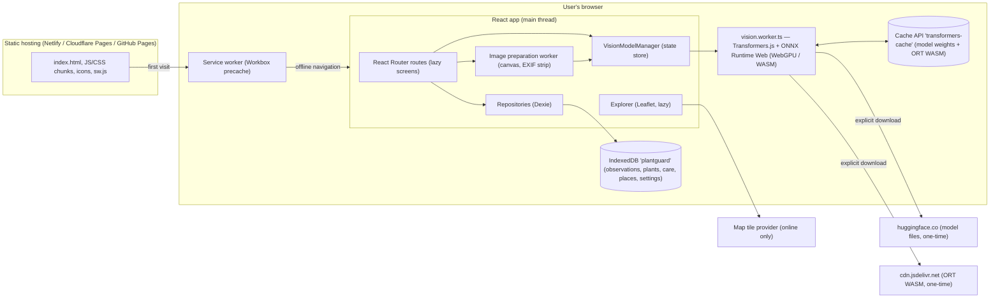

# Architecture

PlantGuard AI is a **static, local-first PWA**. There is no application server or database
server: the browser holds all user data, runs the AI model, and serves the app offline.

## Module boundaries

| Layer | Folder | Responsibility | Must not |
|---|---|---|---|
| App shell | `src/app`, `src/components/layout` | Config, providers, routing, navigation | Talk to IndexedDB directly |
| Features | `src/features/*` | Screens, feature components/hooks/services | Import Dexie tables in components (use repositories) |
| AI | `src/ai` | Provider contracts, worker, model manager, prompts, parsing | Know about React screens |
| Data | `src/db` | Schema, migrations, typed repositories | Contain UI logic |
| Services | `src/services` | Image processing, geolocation, maps config, connectivity, storage, backup | Hold React state |
| UI kit | `src/components/ui`, `feedback`, `common`, `charts` | Reusable presentational components and design tokens | Hold business rules |

`src/app/config.ts` is the only module that reads `import.meta.env`.

## Key data flows

**Scan → save**

1. `ScannerPage` receives a `File` (gallery input) or a `Blob` (getUserMedia capture).
2. `prepareImage` validates type/size/signature, decodes with orientation applied, resizes to
   `VITE_AI_MAX_IMAGE_DIMENSION`, re-encodes as JPEG (removes EXIF) and makes a thumbnail. On browsers with OffscreenCanvas this runs in image.worker.ts; others use local asynchronous preparation.
3. `modelManager.analyze()` → `TransformersVisionProvider` → `runAnalysis()` posts one
   `generate` message per question to the worker (the Blob is structured-cloned, not copied as pixels).
4. The worker loads `RawImage.fromBlob`, applies the chat template and runs `model.generate`.
5. Answers are parsed and validated into a `PlantAssessment` on the main thread.
6. `createObservation` stores the record (+ optional photo, always the thumbnail) in IndexedDB.
   Live queries (`dexie-react-hooks`) update the dashboard, history and streaks.

**Model lifecycle** — see [AI_MODEL.md](AI_MODEL.md#download-and-cache-lifecycle). States:
`checking → not-downloaded | offline-unavailable | unsupported → downloading → loading → ready ⇄ running`, plus `error`.

**Streaks** — `useCareData` merges per-day care completions and observations; pure functions in
`features/care/services/streaks.ts` compute current/best streaks (rules in
[REQUIREMENTS.md](REQUIREMENTS.md#care-streaks)).

## Failure handling

| Failure | Handling |
|---|---|
| Invalid env config | `parseConfig` throws `ConfigError`; `main.tsx` renders an explicit startup error page. |
| Screen crash / chunk load failure | Route `errorElement` (`RouteError`) with offline-aware message; the rest of the app keeps working. |
| Model download/network/quota/memory error | Classified (`classifyModelError`) and shown with an action (retry, lite model, CPU mode). |
| Worker crash (e.g. OOM) | Pending requests reject with `memory`; model marked not-in-memory; next use re-initialises. |
| WebGPU session failure | Automatic one-time retry on WASM (unless the user forced WebGPU). |
| Malformed model output | Parser degrades to `insufficient_evidence` + warnings; schema failure → `RESULT_VALIDATION_FAILED` error, nothing saved. |
| Storage eviction | Readiness re-checked on launch and on connectivity changes; UI returns to "not downloaded". |
| Map tiles unavailable | Offline notice; list of saved places/observations keeps working. |
| Import failure | Single IndexedDB transaction → automatic rollback. |
| Camera/geolocation denied or unsupported | Typed errors with guidance; gallery upload / manual coordinates remain available. |

## Code splitting

- Eager: dashboard, shell, providers.
- Lazy routes: scanner, history, detail, garden, care, explorer, settings, onboarding.
- Lazy within routes: Leaflet map (`MapView`), Recharts chart (`WeeklyActivityChart`).
- The Transformers.js library (~550 KB) lives only in the worker chunk, which is created on first
  model use — not on page load. Model weights are never part of the bundle.

## Hosting

Any static host that serves `dist/` over HTTPS with an SPA fallback. See
[DEPLOYMENT.md](DEPLOYMENT.md). No backend, secrets or paid services are required.

## Hardening and data integrity

Offline screen readiness verifies offline-assets.json against real precache entries. Model readiness checks pinned model metadata, selected weights and exact runtime assets. Session-only readiness has an explicit repair action. Model worker URLs pin tokenizer probes as well as load options.

saveScan transacts plant/observation/assessment creation; rescans append assessment rows. Timeline code compares symptom sets deterministically without recovery/severity scoring. Clear-all uses the data-management repository, removes assessments/care events, and retains model manifests because weights are kept. Settings writes classify quota failures and display errors. See ASSESSMENT_SCHEMA.md, DATABASE_SCHEMA.md and OFFLINE_PWA.md.
